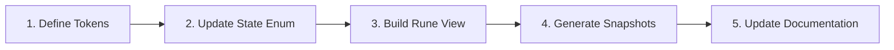

# Workflow: Adding a New Island State

Follow this disciplined 5-step sequence when adding a new state or expanding an existing one in Cay.



---

## Step 1: Define Design Tokens (`design/tokens.json`)
1. Open `design/tokens.json`.
2. Add the state dimensions, corner radius, padding, and specific elements under `states`:
   ```json
   "my_new_state": {
     "width": 320,
     "height": 48,
     "radius": 24,
     "description": "Short explanation of the state"
   }
   ```
3. Ensure all colors and typography refer to existing design tokens.

---

## Step 2: Update Domain Model & State Machine (`cay-core`)
1. In `crates/cay-core/src/state.rs`:
   - Add the variant to `IslandState`.
   - Update `IslandState::dimensions()` to return the new width, height, and corner radius.
   - Update `IslandStateMachine::resolve_priority()` to place the new state in the appropriate priority hierarchy.
2. In `crates/cay-core/src/models.rs`:
   - Add necessary payload structs (e.g. `NewStateData`).
3. Add unit tests in `crates/cay-core/src/state.rs` testing transitions and priority resolution.
4. Verify tests pass:
   ```bash
   cargo test -p cay-core
   ```

---

## Step 3: Implement Rune View (`cay-app`)
1. Create or update view renderer function in `crates/cay-app/src/views/` (e.g. `render_my_new_state`).
2. Construct Rune elements using `row()`, `col()`, `el()`, `text()`.
3. Ensure interactive buttons meet the $\ge 44\text{ px}$ touch target requirement.
4. Hook view into main view dispatcher.

---

## Step 4: Register Headless Scene & Generate Snapshots
1. Register a static scene in `cay-app` `AppSpec.scenes`:
   ```rust
   ("my_new_state", |s| s.set_state(IslandState::MyNewState(...)))
   ```
2. Render headless snapshot:
   ```bash
   cargo run -p cay-app -- --snap snapshots/my_new_state.png --scene my_new_state
   ```
3. Inspect snapshot visual fidelity against `docs/DESIGN.md`.

---

## Step 5: Update Documentation & Commit
1. Update `docs/DESIGN.md` state table with the new state geometry and behaviors.
2. If new user stories or acceptance criteria apply, update `docs/PRD.md`.
3. Commit changes with a descriptive conventional commit (e.g. `feat(island): add my_new_state capsule`).
