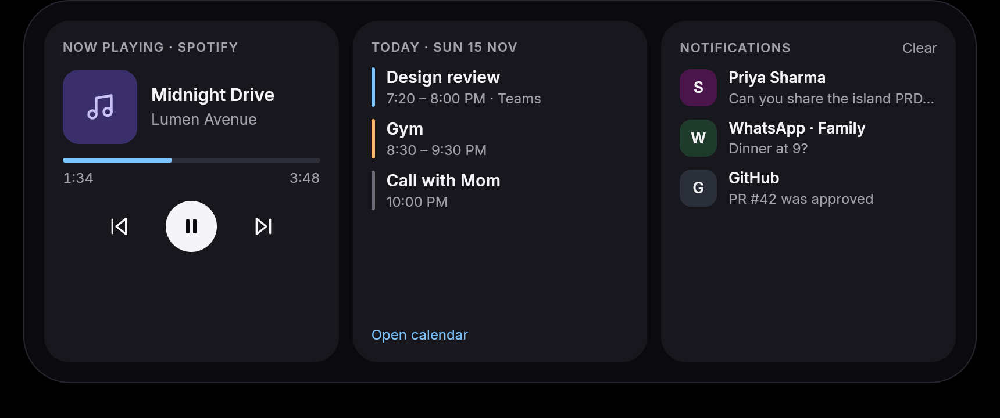
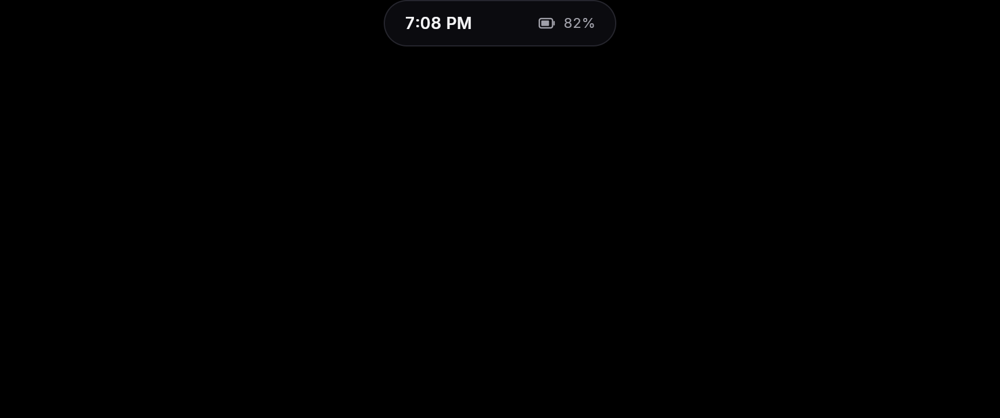
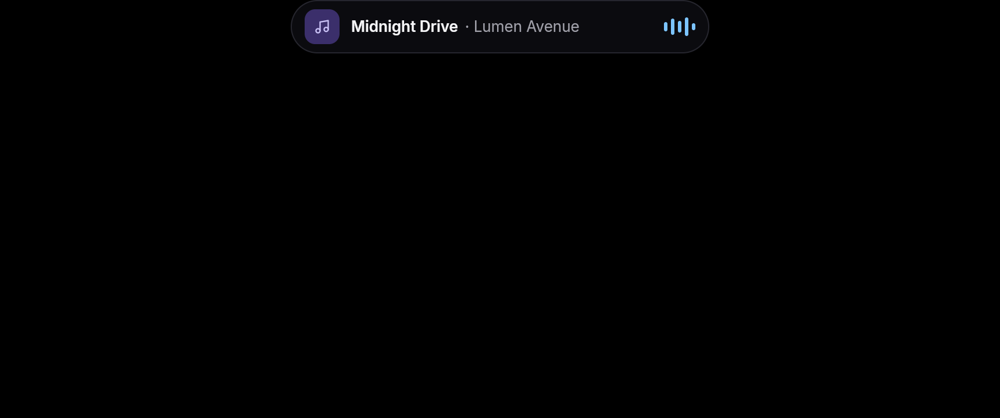
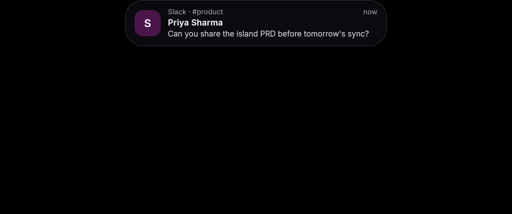
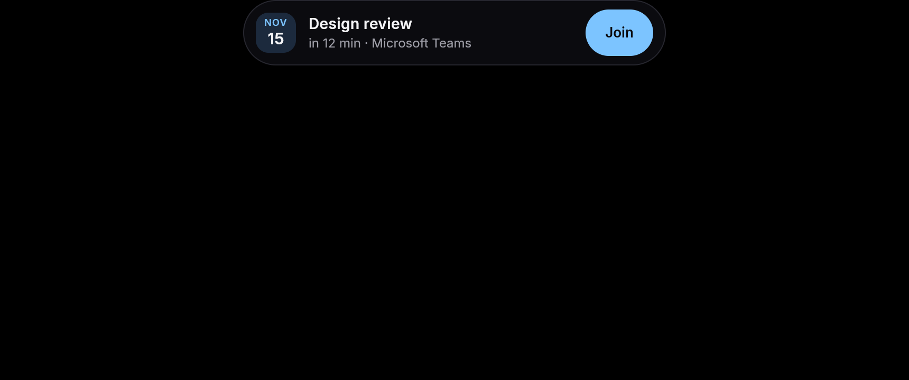
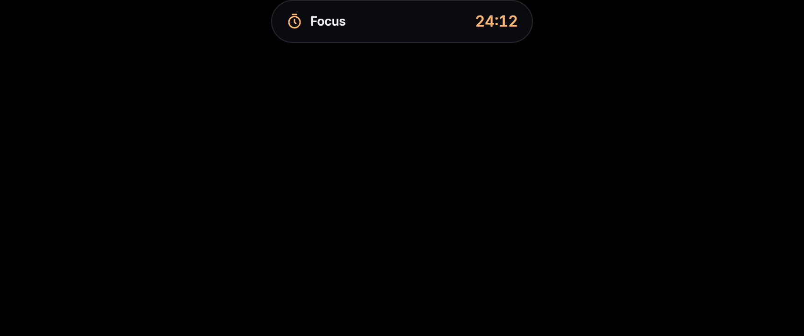
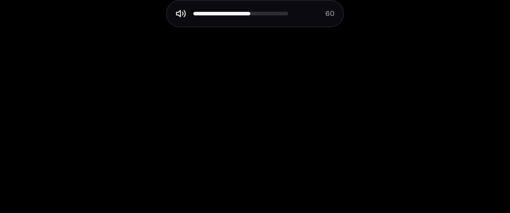

# Cay

**Cay** is a native, hardware-accelerated floating island for Windows 10/11. Anchored to the top centre of the desktop ($14\text{ px}$ from the top edge) as a solid-black pill (`#0B0B0F`), Cay morphs smoothly using analytic spring physics to present media playback, incoming toast notifications, upcoming calendar meetings, focus timers, and system volume HUD indicators—without stealing keyboard focus or cluttering the taskbar.



---

## Features

- **Zero Focus-Stealing & Regional Click-Through**: Built on [Rune](https://github.com/anomalyco/rune) (`Dx12 PreMultiplied, Bgra8Unorm`) with `WS_EX_TOPMOST | WS_EX_TOOLWINDOW | WS_EX_NOACTIVATE` and `OverlayInput::Regions`. Clicks outside the active pill pass directly through to background windows (`WS_EX_TRANSPARENT` / `HTTRANSPARENT`), while hovers and clicks on the pill never deactivate the foreground application.
- **Live System Media Transport Controls (SMTC)**: Streams active track title, artist, timeline progress, and encoded album art thumbnails (`GetThumbnailAsync`) from Spotify, browsers, and desktop media players, with a 5-bar spring-animated waveform and interactive play/pause/previous/next controls.
- **Toast Notification Peek & Unread Cache**: Captures Windows toasts via `UserNotificationListener` (`KnownNotificationBindings::ToastGeneric`), displaying a 5.0-second peek banner ($440 \times 78\text{ px}$) before folding back while retaining unread notifications in the Expanded Hub.
- **RFC 5545 `.ics` Calendar & One-Click Join**: Parses `.ics` calendar feeds (`CAY_ICS_PATH` or `ics_source` in settings), automatically detects Microsoft Teams, Google Meet, and Zoom links, and displays an upcoming meeting alert 15 minutes before start time with a direct **Join** button.
- **Focus / Pomodoro Timer**: Built-in countdown timer ($280 \times 46\text{ px}$) controllable via the System Tray (`Start 25 min`, `Pause / Resume`, `Stop`).
- **Windows Core Audio Volume HUD**: Monitors master audio output volume (`IMMDeviceEnumerator` + `IAudioEndpointVolume`) and triggers a 2.0-second $300 \times 46\text{ px}$ HUD flyout when system volume changes.
- **Fullscreen App & Game Concealment**: Automatically hides the overlay when a foreground game, video, or presentation occupies the entire monitor (`GetMonitorInfoW`), restoring it upon returning to windowed or desktop view.
- **Do Not Disturb & Windows Focus Assist Sync**: Automatically suppresses notification peeks when Windows Quiet Hours / Focus Assist / Presentation Mode is active (`SHQueryUserNotificationState`) or when manual DND is toggled.
- **Multi-Monitor Targeting & Persistent Settings**: Choose between **Primary Monitor** and **Follow Pointer Monitor** (`DisplayTarget::UnderPointer`), select from 4 accent presets (`Sky`, `Lime`, `Warm`, `Purple`), filter out noisy notification apps, and toggle Windows autostart (`HKCU\...\Run`). Preferences persist automatically in `%APPDATA%\Cay\settings.json`.
- **Keyboard Accessibility**: Global shortcut **`Win + Alt + I`** toggles the Expanded Hub from anywhere on Windows; pressing **`Esc`** collapses the Hub.

---

## Island States & Geometry

All visual tokens and dimensions are defined in [`design/tokens.json`](./design/tokens.json) and [`docs/DESIGN.md`](./docs/DESIGN.md):

| State | Dimensions ($W \times H$) | Radius | Preview | Description |
|---|---|---|---|---|
| **1. Idle** | $200 \times 40\text{ px}$ | $20\text{ px}$ |  | Live 12-hour system clock and battery percentage |
| **2. Now Playing** | $360 \times 46\text{ px}$ | $23\text{ px}$ |  | $30\text{ px}$ album art, track title · artist, 5-bar accent waveform |
| **3. Notification** | $440 \times 78\text{ px}$ | $30\text{ px}$ |  | $44\text{ px}$ app badge, app · channel, sender, message preview (5.0 s peek) |
| **4. Upcoming Event** | $400 \times 62\text{ px}$ | $31\text{ px}$ |  | Date tile, meeting title, countdown, and **Join** pill button |
| **5. Timer / Focus** | $280 \times 46\text{ px}$ | $23\text{ px}$ |  | Timer icon, Focus label, and tabular countdown (`#FFB86B`) |
| **6. Volume HUD** | $300 \times 46\text{ px}$ | $23\text{ px}$ |  | Speaker icon, level bar (`#F5F5F7` on `#2E2E38`), and volume level (2.0 s) |
| **7. Expanded Hub** | $820 \times 330\text{ px}$ | $40\text{ px}$ |  | 3 equal cards ($18\text{ px}$ padding, $12\text{ px}$ gap): Now Playing, Today, Notifications |

### State Priority Hierarchy
When multiple states are active simultaneously, the island arbitrates deterministically:

$$\text{HUD (2.0 s Interrupt)} > \text{Notification Peek (5.0 s)} > \text{Upcoming Event (15 m)} > \text{Timer / Focus} > \text{Now Playing} > \text{Idle}$$

---

## Workspace Architecture

```text
Cay/
├── AGENTS.md                    # Single source of truth for coding agents
├── CLAUDE.md                    # Claude Code pointer (@AGENTS.md)
├── Cargo.toml                   # Workspace manifest & Rune vendored crate patches
├── design/
│   ├── tokens.json              # Design tokens (colors, radii, typography, state sizes, motion)
│   └── reference/               # Interactive HTML/CSS design canvas prototypes
├── docs/
│   ├── PRD.md                   # Product Requirements Document
│   ├── DESIGN.md                # Visual specification & state geometry table
│   ├── ARCHITECTURE.md          # Crate boundaries, threading model, & UI seam
│   ├── RESEARCH.md              # Prior art analysis & WinRT subsystem notes
│   ├── ROADMAP.md               # Milestone status (Phase 0 Spike → MVP → P1 → P2)
│   └── adr/
│       └── 0001-ui-framework-rune.md # ADR: Rune selection & Tauri 2 fallback trigger
├── .agents/
│   ├── rules/                   # Project, Rust, WinRT, Design Fidelity, and Testing rules
│   ├── workflows/               # Step-by-step runbooks (Spike, Add State, Verify UI, Release)
│   └── skills/                  # Specialized skills (Rune UI, Windows Media & Notifications)
├── snapshots/                   # Headless PNG snapshots for all 7 island states
└── crates/
    ├── cay-core/                # Pure Rust domain models, state machine, & RFC 5545 .ics parser
    ├── cay-providers/           # Windows WinRT/Win32 providers behind traits + headless stubs
    └── cay-app/                 # Native Rune overlay shell, views, tray menu, & MTA worker loop
```

- **`crates/cay-core`**: Zero OS or UI dependencies. Houses [`IslandStateMachine`](./crates/cay-core/src/state.rs), priority arbitration, auto-dismissal timers, [`IslandSettings`](./crates/cay-core/src/models.rs), and [`parse_ics_meetings`](./crates/cay-core/src/ics.rs).
- **`crates/cay-providers`**: Zero UI dependencies. Implements [`WinSmtcMediaProvider`](./crates/cay-providers/src/windows_impl.rs), [`WinNotificationProvider`](./crates/cay-providers/src/windows_impl.rs), [`WinSystemProvider`](./crates/cay-providers/src/windows_impl.rs), [`IcsCalendarProvider`](./crates/cay-providers/src/calendar_ics.rs), Core Audio master volume reader, fullscreen detector, and global hotkey listener on background COM MTA threads.
- **`crates/cay-app`**: Wires `cay-providers` $\to$ `cay-core` $\to$ Rune views with system tray management and headless snapshot scenes.

---

## Building, Running & Testing

### Prerequisites
- **OS**: Windows 10 (1903+) or Windows 11
- **Toolchain**: Rust 1.80+ (`msvc` target) with Visual Studio C++ Build Tools & Windows SDK

### Commands

```powershell
# Build the workspace
cargo build

# Run Cay Floating Island on the desktop
cargo run -p cay-app

# Run with a local .ics calendar file
$env:CAY_ICS_PATH="C:\path\to\calendar.ics"; cargo run -p cay-app

# Run all unit tests
cargo test --workspace

# Run Clippy lints (zero warnings policy)
cargo clippy --workspace --all-targets -- -D warnings

# Check formatting
cargo fmt --all -- --check

# Render headless PNG snapshots for every island state
cargo run -p cay-app -- --snap snapshots/idle.png --scene idle
cargo run -p cay-app -- --snap snapshots/now_playing.png --scene now_playing
cargo run -p cay-app -- --snap snapshots/notification.png --scene notification
cargo run -p cay-app -- --snap snapshots/upcoming_event.png --scene upcoming_event
cargo run -p cay-app -- --snap snapshots/timer.png --scene timer
cargo run -p cay-app -- --snap snapshots/hud.png --scene hud
cargo run -p cay-app -- --snap snapshots/hub.png --scene hub
```

---

## Controls & Configuration

### Interactions & Shortcuts
- **Hover or Click Pill**: Expands into the 3-card **Expanded Hub** (hover expansion can be toggled on/off from the System Tray).
- **`Win + Alt + I`**: Global keyboard shortcut to toggle the Expanded Hub from any application.
- **`Esc`**: Collapses the Expanded Hub back to the active pill state.
- **System Tray Icon**: Left-click to toggle the Hub; right-click to start/pause/stop the 25-minute Focus Timer, switch accent presets (`Sky`, `Lime`, `Warm`, `Purple`), switch display target (`Primary Monitor` vs `Follow Pointer Monitor`), toggle Do Not Disturb, toggle Hover Expansion, configure Windows Autostart, or quit.

### Settings File (`%APPDATA%\Cay\settings.json`)
Settings are automatically saved to `%APPDATA%\Cay\settings.json`:

```json
{
  "accent": "Sky",
  "top_offset_px": 14.0,
  "hover_expand_enabled": true,
  "enable_media": true,
  "enable_notifications": true,
  "enable_calendar": true,
  "ics_source": null,
  "monitor_choice": "Primary",
  "do_not_disturb": false,
  "blocked_notification_apps": []
}
```

---

## Documentation Index

- [Product Requirements Document (PRD)](./docs/PRD.md)
- [Design Specification](./docs/DESIGN.md) & [Design Tokens](./design/tokens.json)
- [Architecture & UI Seam](./docs/ARCHITECTURE.md)
- [Prior Art & Technical Research](./docs/RESEARCH.md)
- [Roadmap & Milestone Status](./docs/ROADMAP.md)
- [ADR 0001: Rune UI Framework & Tauri 2 Fallback](./docs/adr/0001-ui-framework-rune.md)
- [Agent Guidelines (`AGENTS.md`)](./AGENTS.md)

---

## License

MIT License.
