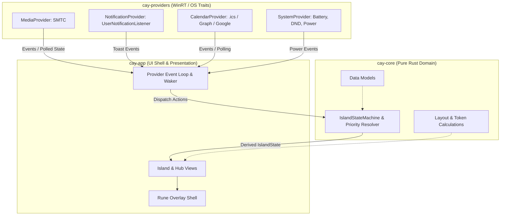
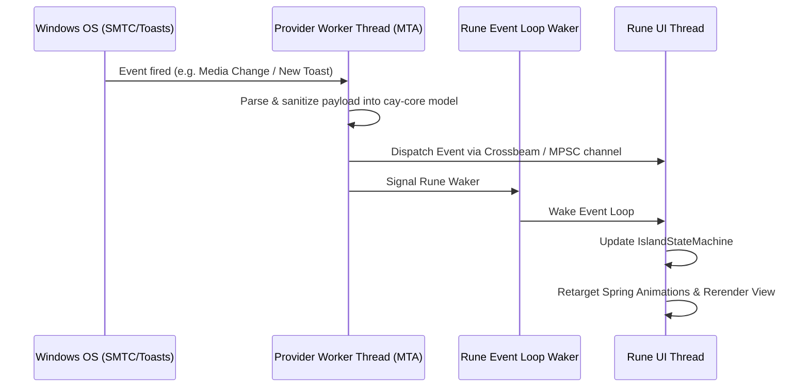

# Architecture Specification: Cay

## 1. System Overview & Crate Boundaries

Cay is architected with a strict separation between domain logic, OS integration providers, and the presentation layer. This guarantees modular testability and maintains a clean UI seam, ensuring that switching the UI framework (e.g. from Rune to Tauri 2) requires no modifications to business logic or hardware/WinRT integrations.

### Crate Division

1. **`cay-core`**:
   - **Dependencies**: Pure Rust (`serde`, `thiserror`). **No Rune, no Windows crate, no OS-specific code**.
   - **Responsibilities**:
     - State machine representing active island states (`Idle`, `NowPlaying`, `Notification`, `UpcomingEvent`, `Timer`, `Hud`, `Hub`).
     - Priority resolution: deterministically decides which state wins when multiple events coexist.
     - Pure domain data structures: `MediaTrack`, `ToastNotification`, `CalendarMeeting`, `TimerState`, `BatteryStatus`.
     - Layout mathematics: state dimensions, corner radii, and padding constants derived from tokens.

2. **`cay-providers`**:
   - **Dependencies**: `windows` crate (WinRT APIs: SMTC, NotificationListener, Power), `windows-core`, `thiserror`, `tokio` or native threads. **No UI or Rune dependencies**.
   - **Responsibilities**:
     - Trait definitions: `MediaProvider`, `NotificationProvider`, `CalendarProvider`, `SystemProvider`.
     - WinRT implementations with robust COM apartment handling (`RO_INIT_MULTITHREADED`).
     - Safe error handling without panics or unwraps.
     - In-memory mock/stub implementations for headless testing and non-Windows compilation.

3. **`cay-app`**:
   - **Dependencies**: `rune`, `rune-motion`, `cay-core`, `cay-providers`, `anyhow`, `tracing`.
   - **Responsibilities**:
     - The Rune application entry point (`main.rs`).
     - Configures the top-pinned `OverlaySpec` with click-through and non-activating window styles.
     - Spawns background worker threads for OS providers and pipes updates into the Rune event loop via `Waker` / `Live` channels.
     - Renders reactive Rune views for the island and Expanded Hub.

---

## 2. Threading Model & Concurrency

Windows WinRT listeners and COM session managers must never run on the main UI thread. Blocking the UI thread degrades animation smoothness from 60 fps to stuttering frames.

- **UI Thread**: Exclusively handles the Rune render loop, input handling, and spring animation ticks.
- **Provider Worker Thread(s)**: Background thread pool initialized in multi-threaded COM apartments (`MTA`) polling or subscribing to OS events.
- **Channel Delivery**: Thread-safe lock-free or MPSC queue dispatching immutable domain events to `cay-app`.

---

## 3. Data Flow: Provider $\to$ State $\to$ View

1. **Provider Ingestion**:
   - `MediaProvider` receives track metadata or playback state change from SMTC.
   - Converts raw WinRT types (`GlobalSystemMediaTransportControlsSessionMediaProperties`) into a clean `cay_core::models::MediaInfo`.
2. **State Arbitration**:
   - `cay_core::state::IslandStateMachine` ingests the action.
   - Runs arbitration logic: if a notification is currently active and within its 5-second display window, the island remains in `Notification` state while updating the background `NowPlaying` state.
   - When the notification expires, the state machine transitions to `NowPlaying`.
3. **View Rendering**:
   - `cay-app` queries `IslandStateMachine::current_state()`.
   - Reads geometry tokens: `(width, height, radius)`.
   - Passes the active model into the corresponding view builder (`render_idle`, `render_now_playing`, `render_hub`).
   - Rune springs interpolate between current visual bounds and the target bounds.

---

## 4. The UI Seam & Fallback Strategy

Rune is a pre-release native Rust framework. To protect the project timeline, the architectural seam between `cay-app` and the underlying domain is strictly preserved:

### Fallback Criteria
If the **Phase 0 Spike** reveals any of the following blockers:
1. `WS_EX_TRANSPARENT` or selective hit-testing fails to pass clicks through transparent overlay regions on Windows 11.
2. The overlay steals keyboard focus from active games or typing windows.
3. Spring animations cannot reliably maintain 60 fps during continuous morphs.
4. Unresolvable crashes in Rune's DirectX 12 / Vulkan renderer on multi-GPU setups.

### Fallback Execution
- `cay-core` and `cay-providers` remain 100% untouched.
- Replace `cay-app` with a Tauri 2 shell (`cay-tauri`).
- The Tauri Rust backend invokes `cay-providers` traits and wraps `cay-core` state machine via Tauri commands and events.
- Frontend implemented in React 19 + Framer Motion using the exact same tokens in `design/tokens.json`.
