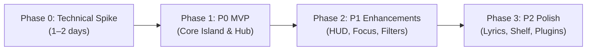

# Roadmap & Phase Milestones: Cay

## Phase Overview

---

## Phase 0: Technical Spike & Architecture Verification

**Duration**: 1–2 days  
**Goal**: De-risk Rune on Windows 11 and validate low-level WinRT capabilities before building out the full application.

### Key Deliverables
1. **Rune Windows Overlay Proof-of-Concept**:
   - Run a minimal Rune overlay on a real Windows 11 desktop.
   - Pinned at top-centre ($14\text{ px}$ from top edge).
   - Solid black pill morphing between $200 \times 40\text{ px}$ (Idle) and $360 \times 46\text{ px}$ (Now Playing) on click via spring animation.
2. **Live SMTC Track Integration**:
   - Connect `cay-providers` SMTC listener to Spotify / Windows Media Player.
   - Stream track title and playback status into the overlay.
3. **WinRT `UserNotificationListener` Identity Check**:
   - Test whether an unpackaged Rust `.exe` can invoke `RequestAccessAsync()` and read notifications, or if package identity (sparse MSIX) is required.

### Exit Criteria (Completed & Verified)
- [x] Overlay is completely transparent outside the pill shape (`Dx12 PreMultiplied, Bgra8Unorm`).
- [x] Stays topmost above maximised windows (`WS_EX_TOPMOST | WS_EX_TOOLWINDOW`).
- [x] Never steals keyboard focus when clicked, morphed, or updated (`WS_EX_NOACTIVATE`).
- [x] Clicks outside the pill pass through cleanly to applications underneath (`OverlayInput::Regions` + `WS_EX_TRANSPARENT` / `HTTRANSPARENT`).
- [x] Clicks and hovers inside the pill register reliably (`.hit()` + `on_hover_change` + `on_press`).
- [x] Smooth Vsync-paced spring morph animation observed without stutter (108 redraws, 107 presents, 0 skipped frames).
- [x] Clear resolution on packaging identity requirement for toasts: `UserNotificationListener::Current().RequestAccessAsync()` returns `Allowed (raw=1)` directly from an unpackaged `.exe` on Windows 11 (no MSIX/sparse package required).
- [x] Live SMTC session (`WinSmtcMediaProvider`) and battery telemetry (`WinSystemProvider`) verified on background MTA worker thread.

*Phase 0 Verdict*: **Proceed with Rune** (no fallback to Tauri 2 required).

---

## Phase 1: P0 MVP (Core Island & Hub)

**Goal**: Complete feature set for daily driving on Windows 10/11.

### Milestones
- **Core Domain State Machine (`cay-core`)**: Full arbitration between Idle, Media, Notifications, Events, and Hub.
- **Media Controls (`cay-providers`)**: Play/pause, track scrubbing, previous/next commands, dynamic album art rasterization.
- **Toast Notifications**: Notification peek banner ($440 \times 78\text{ px}$) with 5.0 s auto-dismissal and unread cache.
- **Calendar Module**: Next meeting countdown with direct "Join" button (Webcal `.ics` / Google OAuth).
- **Expanded Hub**: 3-card dashboard layout with interactive controls.
- **System Tray & Preferences**: Tray icon context menu, autostart toggle, accent color selector, and fullscreen detection.

### Exit Criteria
- [ ] All P0 acceptance criteria verified against real Windows applications.
- [ ] Idle memory footprint verified $< 30\text{ MB}$.
- [ ] Idle CPU usage $< 0.2\%$.
- [ ] Automated headless UI snapshot tests passing for every state.

---

## Phase 2: P1 Enhancements

**Goal**: Deep system integration and power-user workflows.

### Scope
- **Volume & Brightness HUD**: Intercept system volume/brightness keystrokes and display replacing the native Windows flyout.
- **Timer & Focus Capsule**: Pomodoro / focus timer with countdown and audible or visual completion alert.
- **Multi-Monitor Settings**: Display selector allowing users to pin Cay to secondary displays or track cursor position.
- **Notification Whitelist/Blacklist**: User interface in Hub/Settings to filter out noisy apps.
- **Windows Focus Assist / DND Sync**: Island dims or suppresses notification peeks when Windows Focus is engaged.

---

## Phase 3: P2 Extensions & Ecosystem

**Goal**: Advanced widgets and extensible architecture.

### Scope
- **Synced Lyrics Display**: Streaming karaoke-style lyrics line during media playback.
- **Clipboard & File Holding Shelf**: Temporary drop-zone for quick drag-and-drop operations between monitors.
- **Weather Indicator**: Ambient temperature and forecast icon in idle state.
- **Plugin Sandbox**: Extensible API for community integrations.
