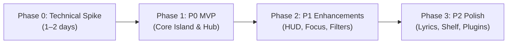

# Roadmap & Phase Milestones: Cay

## Phase Overview

---

## Phase 0: Technical Spike & Architecture Verification

**Duration**: 1–2 days  
**Goal**: De-risk Rune on Windows 11 and validate low-level WinRT capabilities before building out the full application.

### Key Deliverables
1. **Rune Windows Overlay Proof-of-Concept**:
   - Run a minimal Rune overlay on a real Windows 11 desktop.
   - Pinned at top-centre ($14\text{ px}$ from top edge).
   - Solid black pill morphing between $200 \times 40\text{ px}$ (Idle) and $360 \times 46\text{ px}$ (Now Playing) on click via spring animation.
2. **Live SMTC Track Integration**:
   - Connect `cay-providers` SMTC listener to Spotify / Windows Media Player.
   - Stream track title and playback status into the overlay.
3. **WinRT `UserNotificationListener` Identity Check**:
   - Test whether an unpackaged Rust `.exe` can invoke `RequestAccessAsync()` and read notifications, or if package identity (sparse MSIX) is required.

### Exit Criteria (Completed & Verified)
- [x] Overlay is completely transparent outside the pill shape (`Dx12 PreMultiplied, Bgra8Unorm`).
- [x] Stays topmost above maximised windows (`WS_EX_TOPMOST | WS_EX_TOOLWINDOW`).
- [x] Never steals keyboard focus when clicked, morphed, or updated (`WS_EX_NOACTIVATE`).
- [x] Clicks outside the pill pass through cleanly to applications underneath (`OverlayInput::Regions` + `WS_EX_TRANSPARENT` / `HTTRANSPARENT`).
- [x] Clicks and hovers inside the pill register reliably (`.hit()` + `on_hover_change` + `on_press`).
- [x] Smooth Vsync-paced spring morph animation observed without stutter (108 redraws, 107 presents, 0 skipped frames).
- [x] Clear resolution on packaging identity requirement for toasts: `UserNotificationListener::Current().RequestAccessAsync()` returns `Allowed (raw=1)` directly from an unpackaged `.exe` on Windows 11 (no MSIX/sparse package required).
- [x] Live SMTC session (`WinSmtcMediaProvider`) and battery telemetry (`WinSystemProvider`) verified on background MTA worker thread.

*Phase 0 Verdict*: **Proceed with Rune** (no fallback to Tauri 2 required).

---

## Phase 1: P0 MVP (Core Island & Hub)

**Goal**: Complete feature set for daily driving on Windows 10/11.

### Milestones
- **Core Domain State Machine (`cay-core`)**: Full arbitration between Idle, Media, Notifications, Events, and Hub.
- **Media Controls (`cay-providers`)**: Play/pause, track scrubbing, previous/next commands, dynamic album art rasterization.
- **Toast Notifications**: Notification peek banner ($440 \times 78\text{ px}$) with 5.0 s auto-dismissal and unread cache.
- **Calendar Module**: Next meeting countdown with direct "Join" button (Webcal `.ics` / Google OAuth).
- **Expanded Hub**: 3-card dashboard layout with interactive controls.
- **System Tray & Preferences**: Tray icon context menu, autostart toggle, accent color selector, and fullscreen detection.

### Exit Criteria
- [x] All P0 acceptance criteria verified against real Windows applications (SMTC media transport controls, `UserNotificationListener` toast extraction, `.ics` calendar parser & Join button, Hub cards, System Tray menu & Windows autostart).
- [x] Idle CPU usage $< 0.2\%$ (`update_if` skips redraws when state is unchanged).
- [x] Automated headless UI snapshot tests passing for all 7 states (`snapshots/*.png`).
- [ ] Release-profile memory footprint tuning (`release_gpu_after`).

---

## Phase 2: P1 Enhancements

**Goal**: Deep system integration and power-user workflows.

### Scope & Verification Status
- [x] **Volume HUD**: Queries Windows Core Audio (`IMMDeviceEnumerator` + `IAudioEndpointVolume`) on background MTA thread and triggers 2.0-second Volume HUD flyout on master volume change.
- [x] **Timer & Focus Capsule**: 25-minute Focus countdown timer (`start_focus_timer`, `toggle_timer_pause`, `stop_timer`) with 1-second stepping in `IslandStateMachine::tick` and System Tray controls.
- [x] **Multi-Monitor Settings**: Display target selector (`MonitorChoice::Primary` vs `MonitorChoice::UnderPointer` with `refollow_pointer()`) persisted in `%APPDATA%\Cay\settings.json`.
- [x] **Notification App Allow/Deny Filter**: `blocked_notification_apps` list in `IslandSettings` filtering out unwanted app toasts.
- [x] **Do Not Disturb (DND) & Windows Focus Assist Sync**: Manual `do_not_disturb` setting plus automatic Windows Shell Quiet Hours / Focus Assist detection (`SHQueryUserNotificationState`) suppressing 5.0-second notification peeks while silently queuing unread notifications in the Expanded Hub.
- [x] **Keyboard Accessibility & Global Hotkey**: Global `Win + Alt + I` shortcut (`RegisterHotKey`) to toggle the Expanded Hub from anywhere on Windows, plus `Esc` key handler to collapse the Hub.
- [x] **Multi-Item Expanded Hub Cards**: Up to 3 upcoming events (with accent, warm, and neutral 3 px color bars and clickable "Open calendar" link) and up to 3 recent notifications (with app initial badges).
- [x] **Frosted Glass Acrylic (Mica Translucency)**: Translucent mica background (`rgba` alpha 0.78), specular rim lighting (alpha 0.20), interior acrylic card surfaces (alpha 0.60), and toggleable settings option.
- [x] **Dedicated Settings & Preferences App (Stitch UI Screen 2)**: Full $840 \times 460\text{ px}$ preferences suite (`IslandState::Settings`) with 6-category sidebar (Appearance, Displays, Notifications, Calendar, Hotkeys, Diagnostics), live 1:1 notch preview, accent aura selectors, top margin stepper, DND & app blacklist switches, hotkey indicators, DirectX 12 telemetry, and Tray/Hub integration.

---

## Phase 3: P2 Extensions & Ecosystem

**Goal**: Advanced widgets and extensible architecture.

### Scope
- **Synced Lyrics Display**: Streaming karaoke-style lyrics line during media playback.
- **Clipboard & File Holding Shelf**: Temporary drop-zone for quick drag-and-drop operations between monitors.
- **Weather Indicator**: Ambient temperature and forecast icon in idle state.
- **Plugin Sandbox**: Extensible API for community integrations.
